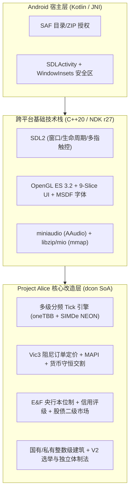

# 维多利亚2 Android 移植与系统重构总方案

## 一、 系统架构总览

---

## 二、 完整技术栈选型清单

仅构建 64 位 **`arm64-v8a`** 目标（淘汰 32 位以保障 `>4GB` 寻址空间与 ARMv8 NEON 寄存器吞吐）：

| 模块层级 | 选用技术 / 库 | 具体用途与选型理由 |
| :--- | :--- | :--- |
| **构建与编译** | `AGP 8.x + CMake 3.28+ + Ninja` + **NDK r27 LTS (Clang 18)** | 完整支持 Project Alice 强依赖的 `C++20 (Concepts / Ranges / constexpr)`；配置 **Host (x86_64) + Target (ARM64)** 双工具链编译 `DataContainerGenerator`。 |
| **窗口与触控** | **`SDL2 (2.30.x LTS)`** | 替换桌面 `Win32 / GLFW`；成熟接管 Android 切后台上下文销毁重建、挖孔屏安全区与多指手势事件。 |
| **图形与着色器** | **`OpenGL ES 3.2`**（备选 `ANGLE`） | 统一通过 GLSL 宏将桌面 `#version 330 core` 映射为 `#version 320 es`；省份 ID 拾取图强制 `GL_NEAREST` 无损采样。 |
| **纹理解码** | **`dds_ktx` + `stb_image`**（可选 `astcenc`） | 解析原版 `.dds (DXT1/DXT5)` 与 `.tga` 贴图；对不支持桌面 BC 硬解的移动 GPU 自动转码为 `RGBA8` 或 `ASTC` 缓存。 |
| **字体与编码** | **`FreeType 2.13` + `HarfBuzz` + `utf8proc`** | 替代 30MB 臃肿 `ICU` 库（配合轻量 `iconv` 完成 `Windows-1252 / GBK / UTF-8` 互转），采用 **SDF 字体图集**实现无损缩放与中文断行。 |
| **SIMD 向量化** | **`SIMDe` (SIMD Everywhere)** | 零侵入将 `dcon` 与数学库中的 x86 `SSE4/AVX2` 内联函数映射为原生 **`ARM NEON`** 128 位指令。 |
| **并发与容器** | **`oneTBB` + `ankerl::unordered_dense`** | 复用 Alice 原生任务并行框架与平坦哈希表；将工作线程数限制为手机大核数（`4~6` 线程）防大小核同步拖慢与发热。 |
| **存储与压缩** | **`minizip-ng` + `mio (mmap)` + `LZ4 / zstd`** | 免解压流式读取用户导入的原版 `.zip` 生成二进制剧本并通过 `mmap` 挂载；`LZ4` 负责 `<0.2s` 切后台快照，`zstd` 负责常规存档压缩。 |
| **音频引擎** | **`miniaudio` + `stb_vorbis`** | 单头文件对接 Android 低延迟 `AAudio / OpenSL ES`，解码原版 `.ogg` 音乐与 `.wav` 音效，移除 `XAudio2/PulseAudio`。 |
| **调试与剖析** | **`Dear ImGui` + `Tracy Profiler` + `Perfetto`** | `ImGui` 仅用于双指点击国旗呼出的内置调试台（省去手写调试 UI 成本）；`Tracy` 无线抓取每帧与分频 Tick 微秒级耗时。 |

---

## 三、 移动端 UI/UX 重排与美术复用规范

1. **零画师成本保留维多利亚美术风格**：
   * 复用 `Project Alice` 的 `.gui` 渲染底层与全部原版 `gfx/interface/*.dds` 贴图、商品图标、POP 立绘、盾牌国旗与衬线字体。
   * **九宫格切图（9-Slice）适配**：对面板贴图保持四角黄铜齿轮/雕花原比例不拉伸，红木金属边框与羊皮纸/深绿绒面底纹按 `20:9` 宽屏尺寸平铺拼接。
2. **`20:9` 横屏主界面（HUD）空间布局**：
   * **单行极简顶栏（高 `40 dp`）**：仅常驻 **国旗与总排名、国库与日收支、通胀率与信用评级、当前科研进度条、关键点数胶囊（焦点/外交/殖民）、报纸通知徽章、右上大号流速/暂停键**。
   * **左侧垂直部门栏（Left Rail）**：利用 `20:9` 左右宽边（内缩避开摄像头挖孔区），纵向排布【生产、预算/央行、市场、科技、政治、人口、外交、军事】8 个主面板图标按钮。
   * **默认折叠小地图（Minimap）**：完整保留原版小地图与地图模式圆钮，但**默认收起为右下角单个黄铜罗盘按钮**；点击展开小地图与图层切换托盘（含新增的 MAPI 物价、通胀本位、公私控股图层），再点收起。
   * **保留报纸（Newspaper）**：不强制全屏打断操作，新期刊生成时在顶栏亮起报纸徽章，点击即可打开经典维多利亚报纸界面查阅国际动态。
   * **默认折叠右侧大纲栏（Outliner）**：收起于右边缘拉手，左滑展开军队、在建工程与势力范围列表。
3. **子面板结构与触控交互规范**：
   * **单焦点窗口 + 半屏三页签省份抽屉**：禁止多窗口重叠拖拽。8 大主面板居中占屏 `85%`（点暗化边缘关闭）；**省份详情改为半屏侧边抽屉**（另一半屏幕保留地图点选对比），内部拆分为 `[概览/军事]`、`[RGO/本地物价]`、`[建筑/投资]` 三个二级页签。
   * **卡片化改造与账本精简**：工厂面板改为“左列选州 + 右侧整数级大卡片流”；POP 面板改为“阶层/职业折叠卡片 + 饼图”；统计账本（Ledger）裁剪保留 **5 页核心榜单**（国力总分、全球商品产销、各国央行汇率/评级、陆海军力、本国收支）。
   * **触控手势与无悬停替代**：单指点击选中（热区最小 `44x44 dp`）、单指拖拽平移、双指缩放、**选中军队长按目标省份 `0.3s` 行军**；**短按执行 / 长按 `0.25s` 锁定 Tooltip 气泡**，并在右侧提供 `[?]` 查词开关与框选军队开关。

---

## 四、 计算与性能优化方案

1. **多级分频 Tick 引擎（削减单日算力峰值 `70%+`）**：
   * **每日 Tick**：军事移动、陆海战斗结算、外交响应、两阶段建造进度推进。
   * **每周 Tick（按 `Province_ID % 7` 均摊至每日）**：计算市场买卖订单汇总（采用**省份订单增量缓存 `Delta Cache`**，每日仅将当日 `1/7` 省份的订单变化量 $\Delta S, \Delta D$ 更新至市场总池，消除跨日价格震荡）、价格与 MAPI 结算、建筑工资竞价与利润分配、央行利率与股市指数更新。
   * **每月 Tick（按 `Province_ID % 30` 均摊至每日）**：POP 自然增长、识字率演进、职业晋升转化、碎片 POP 合并、意识形态偏移、债券利息结算。
2. **数据与渲染降耗**：
   * 移除原版按威望串行抢购排序及 Alice 原生 `600×600` 州际商路寻路；全部价格与需求采用 `32-bit float` 连续数组对齐缓存行，经 `SIMDe` 走 ARM NEON 4 路并行计算。
   * **按需帧率节流**：暂停且无触控输入时自动锁帧 **`15 FPS`**，拖拽或演化时恢复 **`60 FPS`**；首次生成 `.bin` 剧本采用**分块流式解析**，内存峰值严格控制在 **`1.2 GB` 以内**。

---

## 五、 核心玩法机制与数值对标（对标 Project Alice / Vic2 / Vic3）

### 1. 政治、V2 选举与独立体制法（移除组合协同修正）
* **保留 V2 选举与上议院投票**：完整保留 V2 七大意识形态政党、大选周期、造势事件与每年按 POP 意识形态重组的**上议院席位**；发起任何改革或修法须满足**上议院赞成票 `> 50%`**（受斗争度与政治运动加成），通过后经立法冷却生效。
* **国家长期法律 vs 执政党内阁修正**：
  * 在 V2 政治改革（投票权、结社、媒体）与社会改革（最低工资、最高工时、养老、医疗、学制）之外，并入 **经济体制、贸易政策、土地改革、税制、金融货币** 五项国家长期法律（大选换党不直接覆盖现行法律）。
  * 每项法律仅提供清晰的**单项独立修正**（不设跨法律组合协同 Buff）；V2 执政党的固有政策提供额外内阁行政/税率/建设修正，并影响上议院修法倾向。
* **经济体制法单项数值对标（对标 Vic2 政党经济政策与 Vic3 经济法）**：
  * `传统主义`：基础 MAPI `-15%`，私有投资池转化率 `-50%`，国家主动建厂花费 `+25%`。
  * `干预主义`：私有投资池转化率 `+10%`，允许国家新建/扩建、财政补贴、私有化拍卖与出资国有化（标准基准）。
  * `自由放任`：私有投资池转化率 `+25%`，全国私有工厂产出效率 `+5%`（对标 Vic2），禁止长期补贴亏损私企，国家直接新建民用厂花费 `+50%`。
  * `国家资本主义`：国有资产吞吐量 `+10%`，国家新建工厂花费 `-15%`，私有投资池转化率 `-20%`。
  * `计划经济`：取消私有投资池，国内新建建筑国有股锁定 `100%`，重工与基建建造速度 `+20%`，超出行政容量的国企产生递增官僚消耗。

### 2. 市场、价格与 MAPI 系统（对标 Vic3 最新版 + 货币守恒）
* **平滑阻尼订单定价（区间 `[-90%, +120%]`）**：
  基准价 $P_{\text{base}}$ 对标原版 `goods.txt`，供过于求 $\alpha_{-} = 0.90$，供不应求 $\alpha_{+} = 1.20$，阻尼系数 $k = 3.0$（供需比 `2:1` 时温和波动 `-30% / +40%`，`4:1` 以上触及 `0.10 ~ 2.20` 极值）：
  $$P = P_{\text{base}} \cdot \text{clamp}\left(1 + \alpha_{\pm} \cdot \frac{D - S}{3 \cdot \min(D, S) + \epsilon},\ 0.10,\ 2.20\right)$$
* **货币守恒实物交割与短缺惩罚**：
  * **供不应求 ($D > S$)**：买方按 $S/D$ 比例成交并支付 $S \cdot P$；当满足率 `< 75%` 时触发 Vic3 式渐进投入品短缺惩罚（每周累加 `-2%` 建筑吞吐量，封顶 `-75%`）。
  * **供过于求 ($S > D$)**：市场**商业批发库存池**（上限为市场周均需求 `4` 倍，动用商业银行短期信贷）折价吸收余量，溢出部分按实际售出率结算卖方收入，严守货币总量闭环。
* **省份本地价格 (MAPI 数值完全对标 Vic3 `00_defines.txt`)**：
  $$P_{\text{local}} = m \cdot P_{\text{market}} + (1 - m) \cdot P_{\text{prov}}$$
  * 国家级基础 `MAPI_base = 75%`（`传统主义` `-15%` 降至 `60%`；商业科技【证券交易所】`+10%`、后期商业/航空科技合计 `+10%`，最高达 `95%`）。
  * 有效接入度 $m = \text{MAPI}_{\text{base}} \times \text{Access}_{\text{infra}}$，其中基础设施接入度由省份铁路等级（对标 Vic2 `Lv.0 ~ Lv.6`）与港口连通率（遭海军封锁最高扣减 `-80%`）决定。
* **双层共同市场与商船运力池**：
  * 仅【附庸/殖民地】及签署【关税同盟】国家并入宗主国单一市场；普通【势力范围成员】保留独立市场与央行汇率，对宗主国免关税、优先分配自动商路并开放外资准入。
  * 跨海自动商路吞吐上限受**商船运力池**（`海军基地总等级 × 科技系数 + 国内帆船/蒸汽船周采购量`）约束；陆路受边境铁路等级约束。

### 3. 宏观金融与金融二级市场（对标《Vic3: E&F》模组）
* **央行与本位制**：独立货币与浮动汇率（银本位、金本位、复本位要求央行贵金属储备覆盖率基准 `25% ~ 40%`；法定信用货币无贵金属硬锚，由央行基准利率 `0.5% ~ 15.0%` 与货币增速调节）。
* **通胀与通缩区间**：温和通胀 `+1.0% ~ +3.0%`（投资池活性 `+10%`）；恶性通胀 `> +15.0%`（本币汇率暴跌、POP 斗争度月增）；通缩螺旋 `< -2.0%`（扣减工业吞吐量 `-5% ~ -25%` 并加重实际债务负担）。
* **信用评级与股债二级市场**：
  * 动态评定主权信用评级 **`AAA`（发债利率约 `2.5%`）至 `C`（`16.0%+`）**；政府国债利息 100% 回流至持有债券的本国/跨国 POP 与商业银行。
  * 股份制企业通过**股票交易所** IPO/增发募集 POP 储蓄；实体工业大面积亏损将触发股价崩盘与商业银行信贷紧缩（Credit Crunch），冻结民间自动投资池。

### 4. 双轨产权、整数级建筑雇佣与 V2 两阶段建造
* **双轨股权 (`state_ownership_share` $\in [0.0, 1.0]$)**：
  * **国有股**：财政/国债出资，玩家随时可主动新建/扩建，利润上缴国库【国企分红】，可**私有化拍卖**。
  * **私有股与全国分红池**：民间投资池（储蓄 + 股市 + 信贷）出资，AI 按省份 MAPI 预期净利率自动选址（含势力范围跨国投资），可出资**国有化征收**；私有股利润汇入**全国金融分红池**按持仓分给全国资本家及外资。
* **整数等级与工资竞价（对标 Vic2 & Project Alice）**：
  * 建筑与扩建 RGO 统一采用**整数等级（`Lv.1, Lv.2...`）**；每 `1` 级工厂标准容量 **`10,000` 人**（最高 `8,000` 技工 + `2,000` 职员，满职员提供 `+30%` 产出加成）；每升 `1` 级提供 `+1%` 规模经济吞吐加成（随科技上限 `10% ~ 50%`）。
  * 继承 Project Alice 本地劳动力市场工资竞价（受【最低工资法】托底）；亏损无补贴建筑阶梯式降薪裁员但不销毁建筑等级，财政补贴建筑由国库补足工资维持满编。
* **V2 两阶段备料建造**：保留【阶段一：市场订货攒满工地库存 $\to$ 阶段二：走 `180/365/730` 天施工读条】，单工地每周申购上限设为总需求的 **`20%`**（最快 5 周备齐），消除首日脉冲。

### 5. 农矿 RGO、科技、行政、外交与军事数值基准（对标 Vic2 `defines.lua`）
* **多重 RGO 与土地产权**：继承 Project Alice 单省多重特产 RGO 与效率增产品机制，各 RGO 整数扩建上限 $\text{RGO}_{\max} = \lfloor \text{BaseSize} \times \text{TerrainMult} \times (1 + \text{TechBonus}) \rfloor$；基础 RGO 收益初始归本地贵族，随【土地改革法】转向自耕农或全国资本家池；金银 RGO 产出折算入央行贵金属储备；手工业者按月自适应切换至本省 MAPI 净利最高配方。
* **科研、识字率与国家焦点**：保留 V2 5 类 30 分支科技树（央行、法币、股市挂载于商业/工业树），支持 **4 槽位研发队列**。省份神职人员最优科研占比 **`2.0%`**、最优识字率增长占比 **`4.0%`**；省份基础官僚需求 **`1.0%`** 达 `100%` 行政效率；国家焦点支持达标自动轮换至下一人口大省。
* **西化、殖民与外交危机**：保留未开化国家西化树（西化前锁定传统主义与银/实物本位）与殖民争夺（支持 90 天冷却自动加注）。恶名（Infamy）上限 **`25.0`**；列强前 **`1~8` 名**、次列强 **`9~16` 名**（工业分纳入跨国控股市值与主权信用修正）；列强影响力按 `50 / 65 / 100` 阈值由 `[拉拢 / 维持 / 颠覆]` 姿态槽自动执行；新增**武装讨债、条约港与外资特权、黄金储备赔款**三大战争目标。
* **军事、动员与人口叛军**：保留单旅 **`3,000` 人**标准编制、模板一键征召、全国动员与自动平叛/推进；同省同职业 **`< 500` 人**微 POP 按月加权合并（保留 6 大核心意识形态）；起义爆发时按州/大区聚拢生成主力叛军军团。内置缺省参数推导器以兼容 `HoD 3.04` 及 `HPM / GFM` 剧本。

---

## 六、 Project Alice 源码对接与工程闭环项

1. **裁剪与保留边界**：砍掉 `Project Alice` 自带的 `600×600` 州际微市场寻路与多人联机模块；完整保留其 `dcon` 容器、本地工资竞价、复式记账账本、多重 RGO 与原生 `LZ4` 快速序列化。
2. **历史事件字节码 (`Triggers & Effects`) 钩子**：将原版数万条事件中的现金奖惩重定向至央行国库账户划转（严禁凭空印钱），历史关税同盟决议自动绑定统一市场关系。
3. **AI 央行稳定器**：通胀 `> 5%` 自动加息缩表、通缩 `< -1%` 降息扩表，信用评级低于 `BBB` 时暂停举债建厂并拍卖亏损国企。
4. **切后台防杀快照**：响应 Android `onStop` 在 `0.2s` 内通过 `LZ4` 转储 `dcon` 内存块，被系统回收后重开静默秒恢复。

---

## 七、 分阶段实施路线图

1. **阶段一（工具链与引擎底座）**：拉取 `Project Alice` 源码，跑通 Host (`DataContainerGenerator`) + Android NDK (`arm64-v8a`) 双工具链编译，接入 `SDL2 + SIMDe + miniaudio + OpenGL ES 3.2`，实现 `.zip` 流式生成 `.bin` 剧本与地图渲染。
2. **阶段二（移动端 UI 重排与分频底座）**：实现 9-Slice 美术拼接、`20:9` 主界面（单行顶栏 + 左栏 + 默认折叠小地图 + 保留报纸 + 半屏三页签省份抽屉）、点选锁定 Tooltip、长按行军，以及日/周（Delta Cache）/月分频 Tick 与 POP/叛军聚拢。
3. **阶段三（经济、金融与双轨产权内核）**：替换州际商路图为 Vic3 阻尼定价 + MAPI + 货币守恒交割，植入 E&F 央行/信用评级/股债二级市场、整数级双轨建造与工资竞价，打通事件字节码钩子与 AI 央行稳定器。
4. **阶段四（政治法律、新图层与剖析收尾）**：实装独立体制法单项修正与上议院权重、升级列强工业分、新增 3 个经济地图模式、接入 `ImGui` 内置调试台并使用 `Tracy / Perfetto` 完成帧率与发热调优。
